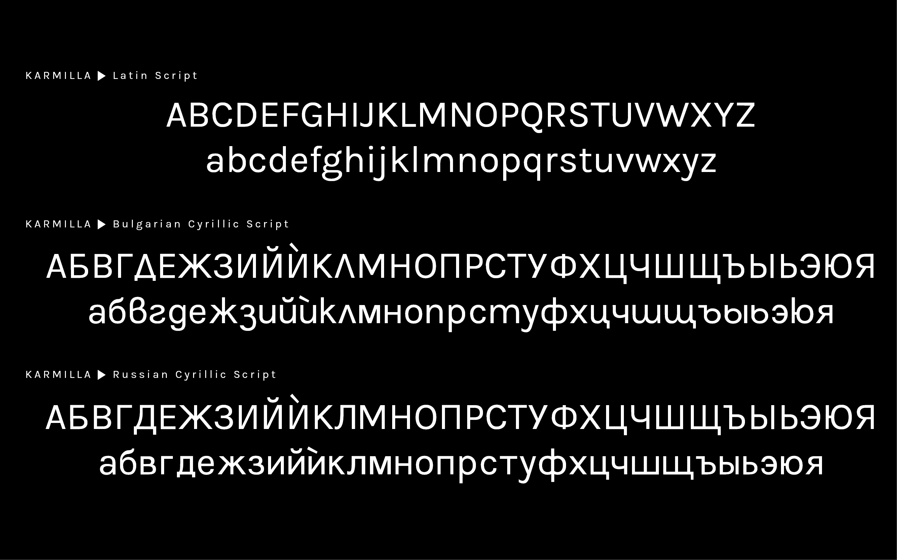

**Karmilla** is an expanded version of **Karla**. 

Karla is an outstanding grotesque sans serif typeface family created by Jonathan Pinhorn ([@jonpinhorn_type](http://twitter.com/jonpinhorn_type), a graduate of the MA in Typeface Design at the University of Reading), released through Google Webfonts in 2012.

The aim of Karmilla is to offer a workaround for designers who want to use Karla but need support for French, German, Norvegian, Slovak or Icelandic, which requires adding and tweaking some glyphs.

The original Karla font can be found here: https://fonts.google.com/specimen/Karla

The source files have been obtained from https://github.com/google/fonts/tree/master/ofl/karla

## Can I install the font on my computer?

Yes you can! You will find the files in the "fonts > ttf" folder. The .ttf extension stands for "TrueType font", a common format for fonts on Mac OS, Microsoft Windows and Linux.

## Can I use Karmilla as a webfont?

Yes of course! For your convenience, we have generated a webfont, which you can find in the "fonts > webfontkit" folder.

## Where are the source files?

You will find them in the "sources" folder.

## What format are they in?

The contributors are working mostly with [FontForge](https://fontforge.github.io/), and we are currently using the native sfdir (SplineFont Directory) format. This format stores each glyph in a single file. We plan to move to the more widespread UFO format at some point in the future (see [issue #17](https://github.com/ms-studio/karmilla/issues/17)).

To open the font with FontForge, do "File > Open", navigate to "sources" and highlight the "Karmilla-Regular.sfdir" folder, and click "OK" – FontForge will open the font. Don't attempt to open a single .glyph file.

## How to generate fonts?

Here is the convention we are using when we make significant changes, such as adding or improving glyphs:

- Increment the version number, under "Element > Font Info".
- Export a new TTF, via "Generate Fonts > TTF".

## Changes:

Some of the changes we made so far:

* added ß for the German alphabet.
* added characters for the Bulgarian and Russian cyrillic alphabet.
* added characters for the Icelandic alphabet.
* added french quotes «», €, ¥, ᴃ
* added å, ø and æ for Scandinavian languages.
* added ç (cedilla) character for better French support.
* added œ (ligatured o and e) character for better French support.
* added various punctuation marks.
* the q character has been streamlined.
* the position of the typographic apostrophe has been changed, so it matches the height of ascenders (l', d').

See the [FONTLOG.txt](https://github.com/ms-studio/karmilla/blob/master/FONTLOG.txt) for details.

## Examples

- See [images](/documentation/) and [Gallery](/documentation/Gallery.md).
- Used on https://marjorieober.com/

## In Collections:

Karmilla has been included in the following font collections:

- The [Open Font Library](https://fontlibrary.org/en/font/karmilla)
- [Font Squirrel](https://www.fontsquirrel.com/fonts/karmilla)
- [Use & Modify](http://usemodify.com/fonts/karmilla/), curated by [Raphaël Bastide](https://github.com/raphaelbastide)
- Interstice Typothèque, curated by Alexandre Liziard & Étienne Ozeray
- Supertypo, curated by Karol Zaharanski

## 🌐 Web Resources & Aesthetic Symbols Index
- [SYM 1F912](https://dark-literary-kaomoji-13.pages.dev/symbol/sym-1f912/)
- [SYM 265C](https://mecha-text-vault-91.pages.dev/symbol/sym-265c/)
- [SYM 1F628](https://coquette-aesthetic-symbols-52.pages.dev/symbol/sym-1f628/)
- [TRENDING](https://anime-sparkle-text-23.pages.dev/ja/trending/)
- [SYM 1F92C](https://pastel-moe-emoticons-80.pages.dev/symbol/sym-1f92c/)
- [SYM 1F63B](https://angelic-bio-symbols-59.pages.dev/symbol/sym-1f63b/)
- [SYM 26B0](https://monochrome-text-lab-86.pages.dev/symbol/sym-26b0/)
- [SYM 1D40B](https://neon-matrix-symbols-74.pages.dev/symbol/sym-1d40b/)
- [SYM 1D441](https://gothic-bio-fonts-86.pages.dev/symbol/sym-1d441/)
- [SPRING TULIP BLOSSOM](https://dark-literary-kaomoji-13.pages.dev/symbol/spring-tulip-blossom/)
- [DISCORD STATUS](https://kawaii-kaomoji-hub-93.pages.dev/ja/discord-status/)
- [RIGHT WHITE CORNER BRACKET](https://witchy-runic-text-71.pages.dev/symbol/right-white-corner-bracket/)
- [SYM 26DA](https://gothic-bio-fonts-86.pages.dev/symbol/sym-26da/)
- [MUSIC WEATHER](https://dolly-kaomoji-text-94.pages.dev/pt/music-weather/)
- [SYM 2747](https://sleek-bio-symbols-51.pages.dev/symbol/sym-2747/)
- [SYM 1F611](https://futuristic-gaming-fonts-52.pages.dev/symbol/sym-1f611/)
- [SYM 263A FE0F](https://dark-literary-kaomoji-13.pages.dev/symbol/sym-263a-fe0f/)
- [SYM 1F600](https://coquette-aesthetic-symbols-52.pages.dev/symbol/sym-1f600/)
- [SYM 1D49A](https://cyber-clan-tags-23.pages.dev/symbol/sym-1d49a/)
- [SYM 2647](https://coquette-aesthetic-symbols-52.pages.dev/symbol/sym-2647/)
- [SYM 1D456](https://pastel-moe-emoticons-80.pages.dev/symbol/sym-1d456/)
- [SYM 1FAE5](https://mecha-synth-kaomoji-92.pages.dev/symbol/sym-1fae5/)
- [INSTAGRAM BIO](https://futuristic-gaming-fonts-52.pages.dev/es/instagram-bio/)
- [PINWHEEL STAR](https://sleek-bio-symbols-51.pages.dev/symbol/pinwheel-star/)
- [SYM 26C1](https://dolly-kaomoji-text-94.pages.dev/symbol/sym-26c1/)
- [SYM 1F607](https://cyber-clan-tags-23.pages.dev/symbol/sym-1f607/)
- [SYM 1F610](https://soft-bow-fonts-22.pages.dev/symbol/sym-1f610/)
- [SYM 1F620](https://pastel-moe-emoticons-80.pages.dev/symbol/sym-1f620/)
- [SKULL AND CROSSBONES](https://futuristic-gaming-fonts-52.pages.dev/symbol/skull-and-crossbones/)
- [SYM 26BF](https://monochrome-text-lab-86.pages.dev/symbol/sym-26bf/)
- [BLACK HEART](https://ribbon-heart-fonts-86.pages.dev/symbol/black-heart/)
- [SYM 2611](https://scholarly-vintage-symbols-48.pages.dev/symbol/sym-2611/)
- [SYM 1F617](https://mecha-synth-kaomoji-92.pages.dev/symbol/sym-1f617/)
- [SYM 2672](https://coquette-aesthetic-symbols-14.pages.dev/symbol/sym-2672/)
- [SYM 1F92A](https://ribbon-heart-fonts-86.pages.dev/symbol/sym-1f92a/)
- [RIGHT WING CLAN FLARE](https://gothic-bio-fonts-86.pages.dev/symbol/right-wing-clan-flare/)
- [UPWARD DIAGONAL ARROW](https://coquette-aesthetic-symbols-52.pages.dev/symbol/upward-diagonal-arrow/)
- [SYM 1F912](https://cyber-clan-tags-23.pages.dev/symbol/sym-1f912/)
- [SYM 1D45E](https://minimal-star-symbols-25.pages.dev/symbol/sym-1d45e/)
- [SYM 260A](https://dolly-kaomoji-text-94.pages.dev/symbol/sym-260a/)
- [RIGHT BLACK LENTICULAR BRACKET](https://sleek-bio-symbols-51.pages.dev/symbol/right-black-lenticular-bracket/)
- [KHANDA EMBLEM](https://matrix-glitch-text-59.pages.dev/symbol/khanda-emblem/)
- [SYM 2688](https://alchemical-symbol-hub-52.pages.dev/symbol/sym-2688/)
- [MUSIC SHARP SIGN](https://balletcore-unicode-67.pages.dev/symbol/music-sharp-sign/)
- [SYM 1D46E](https://matrix-glitch-text-37.pages.dev/symbol/sym-1d46e/)
- [KHANDA EMBLEM](https://monochrome-text-lab-86.pages.dev/symbol/khanda-emblem/)
- [SYM 2643](https://kawaii-kaomoji-hub-93.pages.dev/symbol/sym-2643/)
- [SYM 26AC](https://baroque-text-decor-84.pages.dev/symbol/sym-26ac/)
- [TIKTOK CAPTIONS](https://modern-bullet-symbols-45.pages.dev/vi/tiktok-captions/)
- [TAURUS ZODIAC BULL](https://mecha-synth-kaomoji-92.pages.dev/symbol/taurus-zodiac-bull/)
- [SYM 26A2](https://cyber-clan-tags-23.pages.dev/symbol/sym-26a2/)
- [SYM 1F916](https://soft-pastel-unicode-78.pages.dev/symbol/sym-1f916/)
- [SYM 263B](https://dolly-kaomoji-text-94.pages.dev/symbol/sym-263b/)
- [INSTAGRAM BIO](https://manga-emotion-symbols-69.pages.dev/ru/instagram-bio/)
- [SYM 1D47E](https://soft-bow-fonts-22.pages.dev/symbol/sym-1d47e/)
- [SYM 2624](https://manga-emotion-symbols-69.pages.dev/symbol/sym-2624/)
- [SYM 273E](https://manga-emotion-symbols-69.pages.dev/symbol/sym-273e/)
- [FREEFIRE NAMES](https://zen-aesthetic-fonts-87.pages.dev/ja/freefire-names/)
- [GEMINI ZODIAC TWINS](https://pastel-moe-emoticons-80.pages.dev/symbol/gemini-zodiac-twins/)
- [SYM 1D479](https://clean-aesthetic-fonts-73.pages.dev/symbol/sym-1d479/)
- [SYM 1D42C](https://techno-hacker-text-43.pages.dev/symbol/sym-1d42c/)
- [SYM 26DD](https://cyber-clan-tags-23.pages.dev/symbol/sym-26dd/)
- [GAMING WEAPONS](https://minimal-star-symbols-26.pages.dev/vi/gaming-weapons/)
- [HEAVY HEART EXCLAMATION](https://mecha-synth-kaomoji-92.pages.dev/symbol/heavy-heart-exclamation/)
- [SYM 268A](https://monochrome-text-lab-86.pages.dev/symbol/sym-268a/)
- [SYM 1D4A2](https://sleek-line-unicode-29.pages.dev/symbol/sym-1d4a2/)
- [MUSIC WEATHER](https://zen-aesthetic-fonts-87.pages.dev/vi/music-weather/)
- [ROBLOX NAMES](https://zen-aesthetic-fonts-87.pages.dev/ja/roblox-names/)
- [BRACKETS](https://zen-aesthetic-fonts-87.pages.dev/brackets/)
- [HEAVY STAR](https://mecha-synth-kaomoji-92.pages.dev/symbol/heavy-star/)
- [SYM 1D427](https://kawaii-kaomoji-hub-93.pages.dev/symbol/sym-1d427/)
- [SYM 26D9](https://glitch-mecha-kaomoji-69.pages.dev/symbol/sym-26d9/)
- [INSTAGRAM BIO](https://manga-emotion-symbols-69.pages.dev/instagram-bio/)
- [SYM 1F623](https://pastel-moe-emoticons-80.pages.dev/symbol/sym-1f623/)
- [ARROWS LINES](https://angelic-bio-symbols-59.pages.dev/ja/arrows-lines/)
- [SYM 265A](https://kawaii-kaomoji-hub-93.pages.dev/symbol/sym-265a/)
- [SYM 1F633](https://anime-sparkle-text-58.pages.dev/symbol/sym-1f633/)
- [SYM 26C6](https://coquette-aesthetic-symbols-52.pages.dev/symbol/sym-26c6/)
- [ARROWS LINES](https://angelic-bio-symbols-59.pages.dev/es/arrows-lines/)
- [SYM 26F9](https://cyber-clan-tags-23.pages.dev/symbol/sym-26f9/)
- [ARROWS LINES](https://witchy-runic-text-71.pages.dev/arrows-lines/)
- [SYM 1D499](https://sleek-line-unicode-29.pages.dev/symbol/sym-1d499/)
- [ZODIAC CELESTIAL](https://manga-emotion-symbols-69.pages.dev/vi/zodiac-celestial/)
- [NATURE FLOWERS](https://soft-pastel-unicode-78.pages.dev/pt/nature-flowers/)
- [SYM 262E](https://dolly-kaomoji-text-94.pages.dev/symbol/sym-262e/)
- [INSTAGRAM BIO](https://witchy-runic-text-71.pages.dev/ja/instagram-bio/)
- [RIGHT WING CLAN FLARE](https://dark-literary-kaomoji-13.pages.dev/symbol/right-wing-clan-flare/)
- [SYM 26CF](https://witchy-runic-text-71.pages.dev/symbol/sym-26cf/)
- [SYM 1F604](https://dark-literary-kaomoji-13.pages.dev/symbol/sym-1f604/)
- [SYM 2625](https://manga-emotion-symbols-69.pages.dev/symbol/sym-2625/)
- [SYM 26B7](https://cyber-clan-tags-23.pages.dev/symbol/sym-26b7/)
- [SYM 1D40E](https://zen-spacing-text-68.pages.dev/symbol/sym-1d40e/)
- [SYM 1D49B](https://techno-hacker-text-43.pages.dev/symbol/sym-1d49b/)
- [DISCORD STATUS](https://glitch-mecha-kaomoji-69.pages.dev/pt/discord-status/)
- [SYM 2664](https://witchy-runic-text-71.pages.dev/symbol/sym-2664/)
- [SYM 2749](https://gothic-bio-fonts-61.pages.dev/symbol/sym-2749/)
- [TIKTOK CAPTIONS](https://zen-aesthetic-fonts-87.pages.dev/ja/tiktok-captions/)
- [SYM 26AE](https://kawaii-kaomoji-hub-93.pages.dev/symbol/sym-26ae/)
- [SYM 263A FE0F](https://futuristic-gaming-fonts-52.pages.dev/symbol/sym-263a-fe0f/)
- [SYM 1F979](https://zen-aesthetic-fonts-87.pages.dev/symbol/sym-1f979/)
- [DISCORD STATUS](https://sleek-bio-symbols-51.pages.dev/discord-status/)
- [BLUSHING SOFT SMILE KAOMOJI](https://matrix-hacker-text-52.pages.dev/symbol/blushing-soft-smile-kaomoji/)
- [SYM 1D49D](https://sleek-line-unicode-29.pages.dev/symbol/sym-1d49d/)
- [SYM 26B1](https://coquette-aesthetic-symbols-14.pages.dev/symbol/sym-26b1/)
- [SYM 26BB](https://monochrome-text-lab-86.pages.dev/symbol/sym-26bb/)
- [SYM 1F609](https://cyber-clan-tags-23.pages.dev/symbol/sym-1f609/)
- [LEFT HEAVY BRACKET BOX](https://angelic-bio-symbols-59.pages.dev/symbol/left-heavy-bracket-box/)
- [SYM 1D450](https://raven-gothic-kaomoji-25.pages.dev/symbol/sym-1d450/)
- [SYM 1D478](https://sleek-line-unicode-29.pages.dev/symbol/sym-1d478/)
- [SYM 2662](https://dolly-kaomoji-text-94.pages.dev/symbol/sym-2662/)
- [SYM 1D417](https://sleek-line-unicode-29.pages.dev/symbol/sym-1d417/)
- [SYM 1D41D](https://manga-emotion-symbols-69.pages.dev/symbol/sym-1d41d/)
- [SYM 1F976](https://manga-emotion-symbols-69.pages.dev/symbol/sym-1f976/)
- [SYM 267D](https://sleek-dot-symbols-31.pages.dev/symbol/sym-267d/)
- [BRACKETS](https://zen-aesthetic-fonts-87.pages.dev/pt/brackets/)
- [HEARTS](https://zen-aesthetic-fonts-87.pages.dev/pt/hearts/)
- [SYM 2733](https://manga-emotion-symbols-69.pages.dev/symbol/sym-2733/)
- [SYM 26BD](https://clean-aesthetic-fonts-73.pages.dev/symbol/sym-26bd/)
- [SYM 1D41D](https://dolly-kaomoji-text-94.pages.dev/symbol/sym-1d41d/)
- [SYM 26CF](https://minimal-star-symbols-25.pages.dev/symbol/sym-26cf/)
- [NATURE FLOWERS](https://mecha-blade-symbols-46.pages.dev/pt/nature-flowers/)
- [SYM 1F62B](https://neon-hacker-text-25.pages.dev/symbol/sym-1f62b/)
- [GAMING WEAPONS](https://sleek-dot-symbols-31.pages.dev/ru/gaming-weapons/)
- [SLEEK BIO SYMBOLS 51.PAGES.DEV](https://sleek-bio-symbols-51.pages.dev/)
- [SIXTEEN POINTED STAR](https://glitch-mecha-kaomoji-69.pages.dev/symbol/sixteen-pointed-star/)
- [BEAMED SIXTEENTH MUSICAL NOTES](https://mecha-blade-symbols-46.pages.dev/symbol/beamed-sixteenth-musical-notes/)
- [SYM 1D470](https://manga-emotion-symbols-69.pages.dev/symbol/sym-1d470/)
- [SYM 1FAE1](https://mecha-blade-symbols-46.pages.dev/symbol/sym-1fae1/)
- [HEAVY RIGHTWARD ARROW](https://neon-hacker-text-25.pages.dev/symbol/heavy-rightward-arrow/)
- [FLUTTERING BUTTERFLY](https://neon-hacker-text-25.pages.dev/symbol/fluttering-butterfly/)
